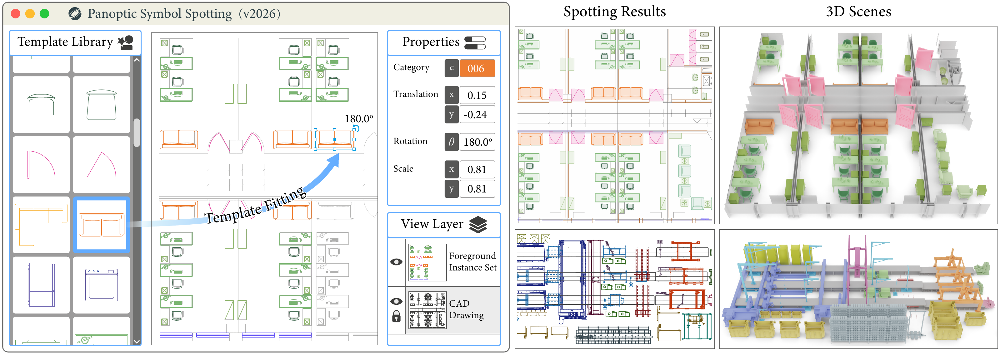

<div align="center">

<h1>TempFit: Panoptic Symbol Spotting via Template Fitting</h1>

<p><strong>SIGGRAPH Asia 2026 (ACM Transactions on Graphics)</strong></p>

<p>Honghao Xu · Hao Wang · Xiang Liu · Juzhan Xu · Manfred Lau · Kai Xu · Ruizhen Hu</p>

<p><a href="https://arxiv.org/pdf/2610.17776"></a> <a href="https://huggingface.co/Daisy-1227/TempFit"></a> <a href="https://huggingface.co/datasets/Daisy-1227/TempFit"></a></p>

<p><a href="assets/teaser.png"></a></p>

</div>

## Preparation

### Environment setup

Install the environment with Conda:

```bash
git clone https://github.com/Daisy-1227/TempFit.git
cd TempFit
conda create -n tempfit python=3.10 pip -y
conda activate tempfit
bash environment/install.sh --conda
```

The installation script downloads the required packages and sets up the environment.

### Data and pretrained weights

The [dataset](https://huggingface.co/datasets/Daisy-1227/TempFit) and [pretrained weights](https://huggingface.co/Daisy-1227/TempFit) are available on Hugging Face.

Request dataset access on its Hugging Face page. Once approved, run these commands from the repository root:

```bash
pip install -U huggingface_hub
hf auth login
hf download Daisy-1227/TempFit TempFit.zip TempFit.zip.sha256 --repo-type dataset --local-dir downloads
(cd downloads && sha256sum -c TempFit.zip.sha256)
python -m zipfile -e downloads/TempFit.zip tempfit-data
cp -r tempfit-data/data tempfit-data/splits .
hf download Daisy-1227/TempFit --include "tempfit-scratch/*" --local-dir checkpoints
```

The resulting layout is:

```text
TempFit/
├── data/industrycad/
│   ├── template-v1/
│   │   ├── train/
│   │   │   ├── svg/
│   │   │   └── gt/
│   │   ├── test/
│   │   │   ├── svg/
│   │   │   └── gt/
│   │   ├── primitive_mapping.json
│   │   ├── invalid_scene.txt
│   │   └── DATA_MANIFEST.json
│   └── resources/
│       ├── templates/
│       ├── model_mapping.json
│       ├── donor/
│       └── invalid_train.txt
├── splits/
│   ├── train.json
│   └── test.json
└── checkpoints/
    └── tempfit-scratch/
        ├── model.safetensors
        └── model.json
```

The default configurations use this layout. To store the data elsewhere, update `paths` in [configs/train.yaml](configs/train.yaml) and [configs/inference.yaml](configs/inference.yaml); relative paths are resolved from the configuration file's directory. Keep `model.json` alongside `model.safetensors`.

## Inference

Run autoregressive inference on the test set:

```bash
python inference.py --config configs/inference.yaml --checkpoint checkpoints/tempfit-scratch/model.safetensors --output_dir outputs/tempfit-test
```

Predictions and metrics are saved to `outputs/tempfit-test/`, including `predictions.json`, `instances.json`, `SUMMARY.json`, and per-scene outputs in `results_val/`.


## Training

To train from scratch on 8 GPUs:

```bash
accelerate launch --multi_gpu --num_processes 8 --mixed_precision bf16 train.py --config configs/train.yaml --output_dir outputs/tempfit-train
```

To train from scratch on a single GPU:

```bash
python train.py --config configs/train.yaml --output_dir outputs/tempfit-train-single
```

The process count is detected at launch. By default, each GPU uses a batch size of 4, and gradient accumulation adjusts to keep the global effective batch size at 128: 4 steps on 8 GPUs, 8 on 4 GPUs, or 32 on a single GPU. Use `--batch_size` and `--grad_accum_every` to set these explicitly. Both launch methods use BF16.


To resume training from a saved checkpoint:

```bash
accelerate launch --multi_gpu --num_processes 8 --mixed_precision bf16 train.py --config configs/train.yaml --resume outputs/tempfit-train/latest.pt --output_dir outputs/tempfit-train
```

To initialize a new training run from the released weights:

```bash
accelerate launch --multi_gpu --num_processes 8 --mixed_precision bf16 train.py --config configs/train.yaml --pretrained checkpoints/tempfit-scratch/model.safetensors --output_dir outputs/tempfit-finetune
```

`--pretrained` loads model weights for a new run. `--resume` restores the model, optimizer, scheduler, and training progress with the same process count and training settings. Both options also work with the single-GPU `python train.py` command. Training settings are defined in [configs/train.yaml](configs/train.yaml).

## Citation

If you have any question about this repo, feel free to drop me an email [littledaisy20001227@gmail.com](mailto:littledaisy20001227@gmail.com)

If you find TempFit useful in your research, please cite our paper:

```bibtex
@article{xu2026tempfit,
    title={TempFit: Panoptic Symbol Spotting via Template Fitting},
    author={Honghao Xu and Hao Wang and Xiang Liu and Juzhan Xu and Manfred Lau and Kai Xu and Ruizhen Hu},
    journal={ACM Transactions on Graphics},
    year={2026},
    url={https://arxiv.org/abs/2610.17776}
}
```

## License

The project's original code and model weights are released under the MIT License. The dataset is released under CC BY-NC 4.0. See [the project license](licenses/PROJECT_LICENSE.txt) and [third-party notices](licenses/THIRD_PARTY_NOTICES.md) for details.

## Acknowledgements

We thank the authors of [Pointcept](https://github.com/Pointcept/Pointcept), [Point Transformer V3](https://github.com/Pointcept/PointTransformerV3), [SymPointV2](https://github.com/nicehuster/SymPointV2), [VecFormer](https://github.com/WesKwong/VecFormer), and [PrimitiveAnything](https://github.com/PrimitiveAnything/PrimitiveAnything) for sharing their code and research.
